::: {.callout-note collapse="true"}
## How this was built
Everything here comes from nba.com/stats: team tracking and shot-clock splits, every shot of the 2026-27 season, a 30-team × 14-season panel (2013-14 to today) with the head coach of record on each team-season, play-by-play for every game of last season and this one, and per-player box scores. Data runs through the Wizards' ninth game (at Atlanta, Nov 6).

One script does all of it: [`keefe_deepdive.R`](https://github.com/jacobpstein/Wizards-Points/blob/main/keefe_deepdive.R). stats.nba.com blocks R outright, so the script carries a small Python fetcher inside it (`curl_cffi`, which can impersonate a browser's TLS handshake), sets up a local virtualenv the first time, pulls everything into a git-ignored cache folder, and then does the analysis and every chart in R. `REFRESH=1 Rscript keefe_deepdive.R` adds the latest games. No data files live in the repo.

Every league comparison is "Nth of 30". Where a number is small-sample (the Wizards have played nine games), it is pulled toward the league average and shown with an interval.
:::

## The short version

Coaches are graded on wins, and wins are mostly the roster. So this post asks a narrower question: of the things a head coach actually decides — how fast to play, who is on the floor, what the defense gives up, when to call timeout, what to run out of it, when to challenge — which ones show up in the data as *his*, and what does Brian Keefe's version of them look like?

Five findings:

1. **An NBA possession lasts about 14½ seconds**, and how long a team takes has essentially no relationship with how well it scores. Tempo is a style, not a skill.
2. **A new coach changes the shape of a team far more than its results.** Across 83 coaching changes since 2013, passing, pace and late-clock stagnation move 25–35% more in a coaching-change offseason than a normal one. Offensive rating, defensive rating and net rating move *less*. And the year after a change, net of bad teams bouncing back anyway, the average new coach's team is about two places *worse* in net rating.
3. **Shot-making, not shot selection, explains offense** (r = 0.70 vs 0.09 across the 30 teams this year). The coach picks the shots; the players make them.
4. **Timeouts don't stop runs; runs stop themselves.** Teams on the wrong end of a 6-0+ run net +0.5 points over the next three minutes if the coach calls time, +0.9 if he plays through it. The plays coaches draw up afterward score *below* their normal rate everywhere in the league.
5. **Keefe, nine games in:** a slower, iso-heavier, three-averse offense that takes the shots analytics likes at the rim and not the ones it likes from deep; a defense that has climbed from worst in the league to the middle, built on not fouling and contesting everything; a rotation that is still being searched, but not one managed off last night's box score; and a timeout habit that has flipped from "most eager run-stopper in the NBA" to one of the most patient.

## 1. How long is a possession, and does it matter?

Using nba.com's tracking time-of-possession divided by possessions, the average NBA offensive possession this season lasts **14.6 seconds**; teams range from about 12½ (Atlanta) to 17½ (Detroit, New York). That matches the arithmetic: at ~100 possessions per team per 48 minutes, each one gets 2,880 ÷ 200 ≈ 14.4 seconds.

The Wizards sit at **14.3 seconds, 17th of 30** — dead average, and a real change from Keefe's first two seasons, when they were among the six fastest teams in the league (pace 4th and 6th). They are now 18th in pace and **28th in passes per possession** (2.5 per trip).

Does any of that matter? Across the 30 teams in each of the last two full seasons, the correlation between possession length and offensive rating is −0.06 and +0.20; between passes per possession and offensive rating, −0.22 and −0.06. Detroit and New York are the two slowest offenses in the league this year and both are good; Sacramento is sixth-slowest and awful. Tempo is a choice, not a quality.

What does carry signal is **when in the shot clock** the shot goes up. League-wide this year: shots with 22–24 seconds left go in at a .60 eFG%, 18–22 at .61, 15–18 at .55, 7–15 at .53, 4–7 at .48, 0–4 at .43. Early is good; stuck is bad.

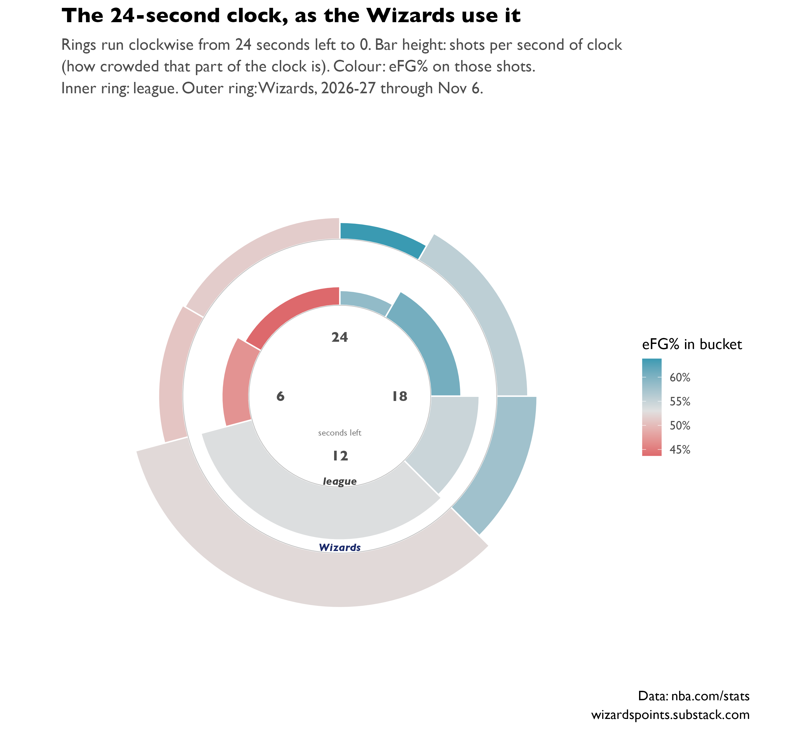

The Wizards' share of early-offense shots (18+ seconds) is 18%, **10th in the league** and almost exactly what it was the last two years. What changed is the other end: the share of shots taken with under 7 seconds has gone from 14–15% (25th–27th, i.e. among the fewest late shots in the league) to **18%, 15th**. The faster rosters didn't get stuck; this one gets stuck a league-average amount.

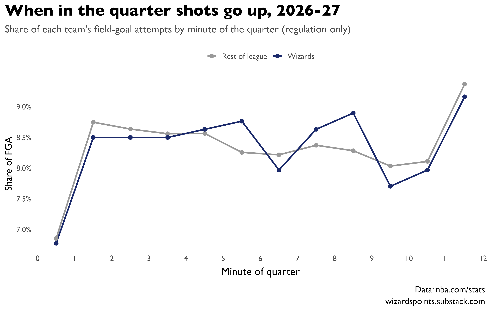

Where in the *quarter* they shoot is flat — 24/26/25/25% across the four three-minute segments, same as the league. There is no "slow starters" or "die late" pattern here. What there is: eFG% of .54 and .59 in the first six minutes of quarters vs .50 and .48 in the last six. The late-quarter dip is where the late-clock shots live.

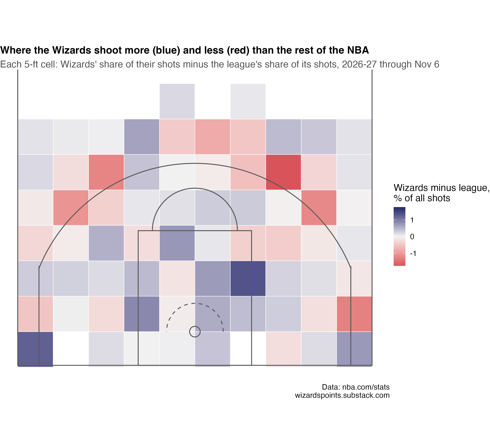

On the court, the change under Keefe is unmistakable. Above-the-break threes have fallen from 35% of shots two seasons ago to **25% (29th in the league)**; mid-range has risen from 9% to **14% (5th)**; restricted-area shots are up to 29% (9th). Rim shooting (.76 eFG%) is carrying the offense.

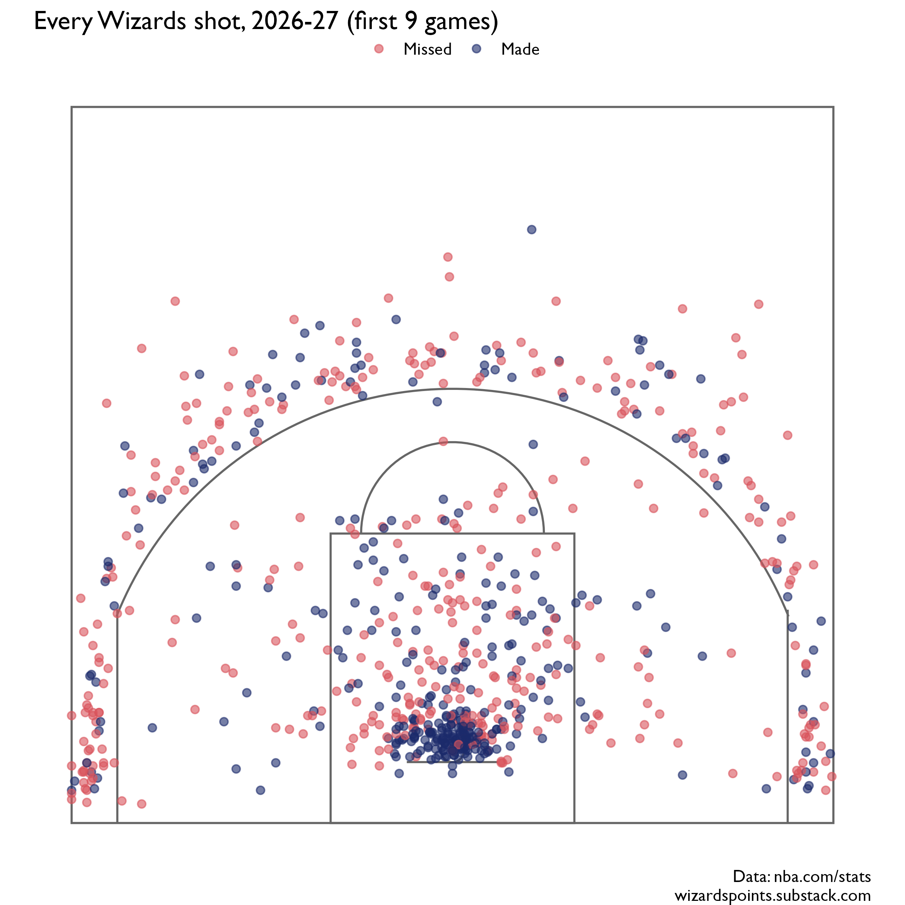

## 2. What a head coach actually controls

### Shot selection is his. Shot making is not.

For each team, take its mix of shot locations and ask what a league-average shooter would post from those spots — the *quality of the shots taken*. Then compare with what the team actually shot — the *quality of the shooters*.

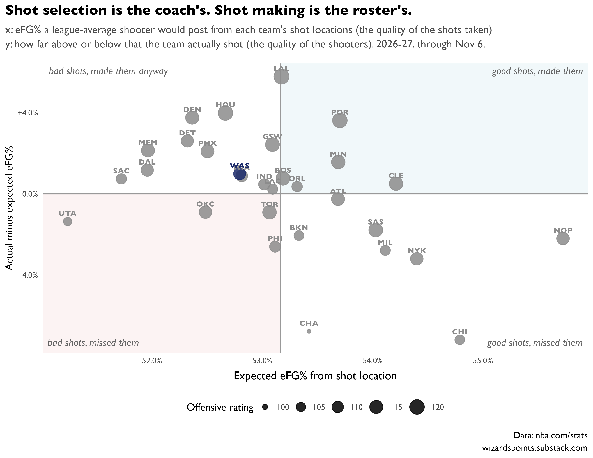

Across the 30 teams, shot quality from location correlates with offensive rating at **r = 0.09**; shot-making correlates at **0.70**. The spread in shot quality between the best and worst shot profile is about four points of eFG%; the spread in shot-making is about fourteen. Chicago has the best shot selection in the league and the worst shooting, and is 1-7. The Wizards take slightly-below-average shots (expected .528, 21st) and make them at almost exactly the expected rate.

### The coaching-change test

The cleanest way to find what belongs to the coach is to watch what happens when he leaves. For 30 teams over 13 full seasons, every stat is converted to a league rank (1st to 30th) and three questions are asked: does a team's rank jump more in an offseason where the coach changed than in one where he stayed? Does a coach's rank on one team predict his rank on the next? And does the stat get better the year after a change, once you allow for the fact that teams that fire coaches were usually bad and bounce back regardless?

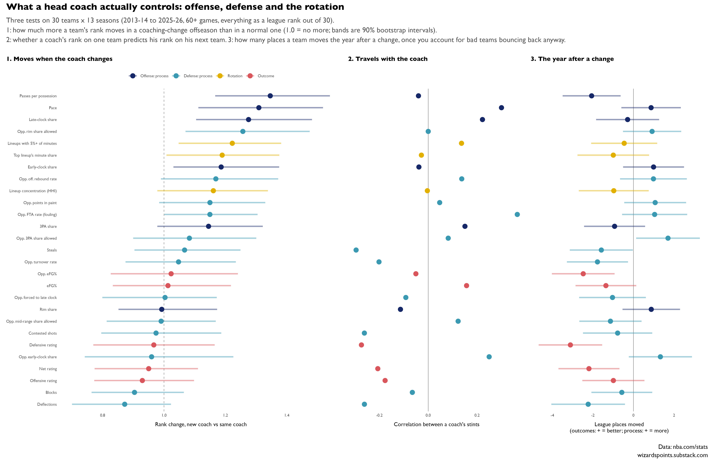

The pattern is clear and a little humbling:

- **Offensive process moves most.** Passes per possession (1.35×), pace (1.31×) and late-clock share (1.28×) all jump far more when the coach changes. Pace and three-point appetite also travel with a coach from team to team (r ≈ 0.27 and 0.15). A coach has a recognisable offensive style.
- **Defensive process moves some.** Where opponents shoot — rim share allowed (1.26×), paint points, offensive rebounds allowed, fouling — shifts with a new coach. How much the defense fouls is the most portable defensive trait a coach has (r = 0.33 between stints).
- **The rotation moves.** How many lineups get real minutes and how much the top lineup plays both change more than normal when the coach changes (1.2×).
- **Outcomes do not.** Offensive rating (0.93×), net rating (0.95×), defensive rating (0.97×) and both eFG%s move no more in a coaching-change offseason than in a normal one. A coach's offensive rating on one team has a slightly *negative* relationship with his rating on the next.
- **The year after a change is, on average, worse.** Net of regression to the mean, teams drop about two places in net rating and three in defensive rating in a new coach's first year. (This is the famous "installation cost"; it is also a reminder that most coaching changes are made for reasons that don't fix the team.)

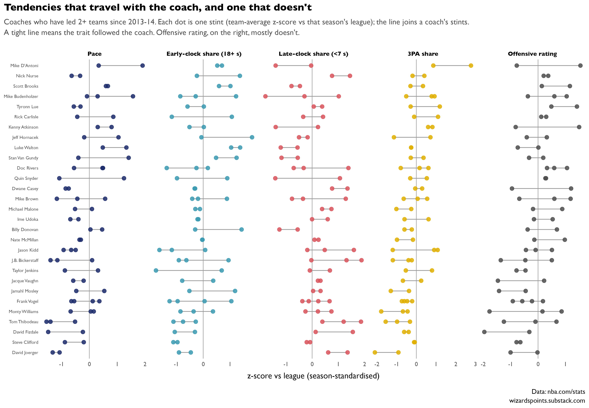

### Thirty fingerprints

Six coach-controlled offensive tendencies, as league ranks, for every current head coach. A petal that reaches the edge is first in the NBA at that thing; one that barely shows is thirtieth. Keefe's is the only one in blue.

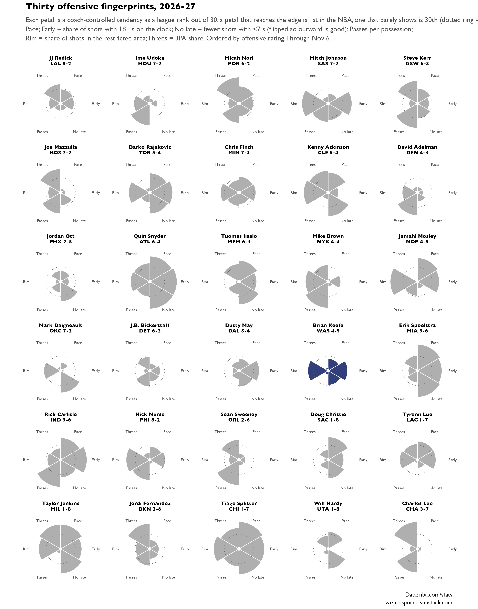

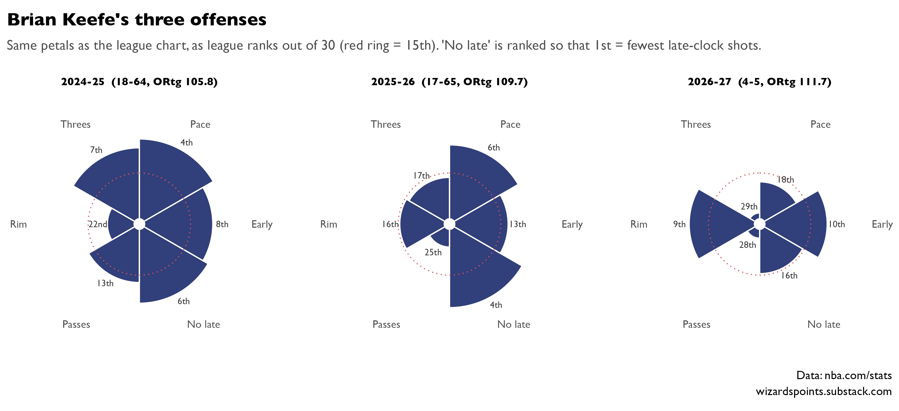

Keefe's three seasons are three different offenses. Year one was a fast, early, three-happy tank. Year three is slow (19th), iso-heavy (28th in passes), three-averse (29th), rim-first (9th), with a mid-range habit (5th). The offensive rating has climbed from 30th to 19th — but the panel above says that climb is the one thing we should *not* credit to the dials.

## 3. The coach's half of the game: defense and the rotation

The obvious objection to section 2: of course the coach doesn't make shots. But he does decide who guards whom, what the scheme concedes, and who is on the floor.

### Defense

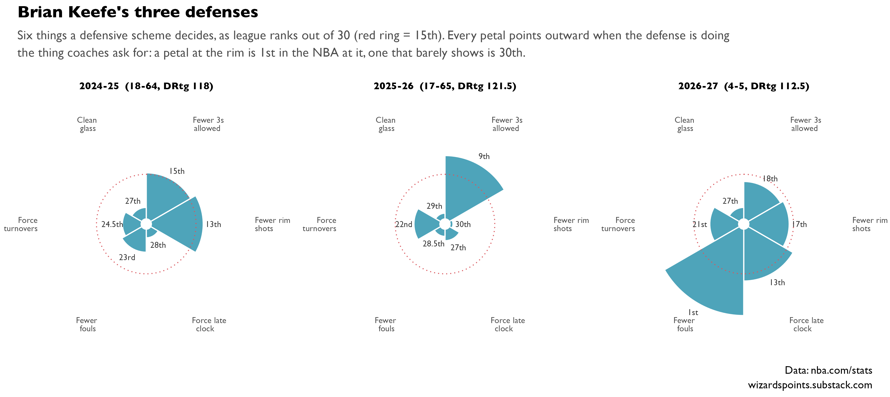

The Wizards had one of the three worst defenses in the league in each of Keefe's first three seasons (3rd-, 3rd- and 1st-worst). This year they are **17th**. The scheme-level dials behind that:

| Defensive dial (2026-27) | Wizards | Rank of 30 |
|---|---|---|
| Opponent eFG% allowed | low | 7th-best |
| Opponent free-throw rate (fouling) | lowest in NBA | **1st** |
| Contested shots per game | high | 3rd |
| Opponent 3PA share allowed | mid | 13th-most |
| Opponents forced to late clock | mid | 13th |
| Opponent turnover rate forced | low-mid | 21st |
| Opponent offensive-rebound rate | high | 4th-worst |
| Deflections | low | 25th |

It is a specific profile: don't foul, contest everything, don't gamble (few deflections, few turnovers forced), and give up the glass. Two of those — fouling and contests — are the defensive traits the panel says are most a coach's own. The two years of "worst defense in the league" were built on the same low-gamble principles with a roster that couldn't contest; the difference this year is that it can. Nine games is nine games, but this is the first season in which the defensive dials and the result point the same way.

### The rotation

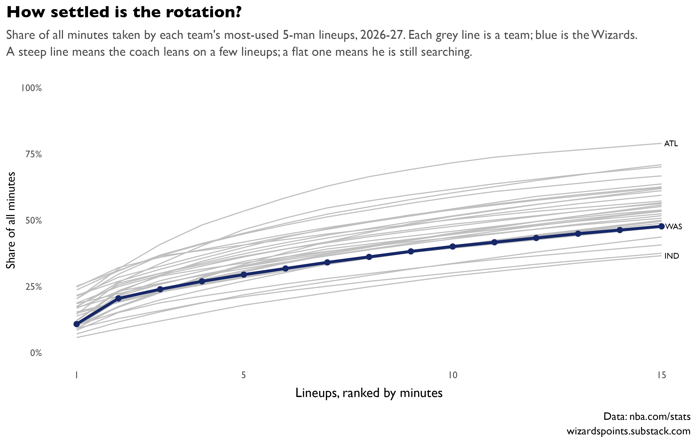

The Wizards' most-used five-man lineup has 11% of the team's minutes (21st); the top fifteen lineups account for 48% of minutes, among the flattest curves in the league. That is a coach still searching — reasonable in November with a roster this young, and consistent with his history: 35 different starting fives in 2024-25 and **51** in 2025-26 (the most in the league), 7.9 starting-lineup changes per 10 games. This year it is 4 starting fives in 9 games.

### Is he managing by the box score?

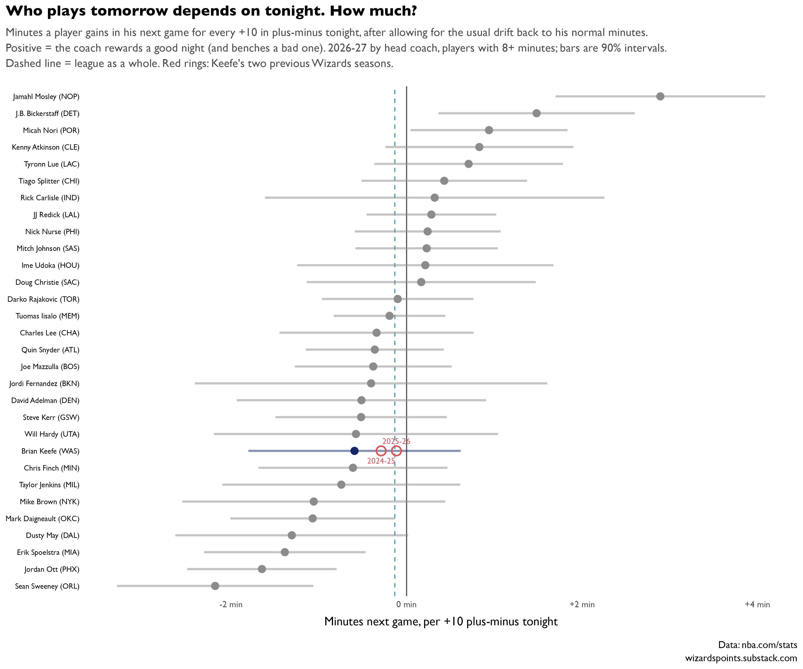

For every player who played 8+ minutes, how much do his minutes change the next game as a function of his plus-minus tonight, after allowing for the usual pull back toward his normal minutes? League-wide the answer is roughly nothing (−0.1 minutes per +10). Keefe's number is **−0.6 minutes per +10 this year** (22nd), −0.3 and −0.1 in his two full seasons. If anything, a good plus-minus night slightly *costs* a Wizard minutes the next game — which is what you'd expect from a coach managing to a plan and to matchups rather than to last night's stat line. Starting-lineup changes have followed losses 75% of the time and wins 50% of the time this year, but with five changes in nine games that is not a pattern yet.

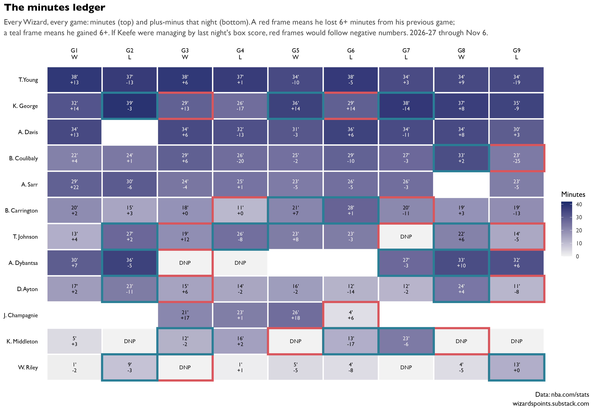

The ledger shows the same thing player by player: the big minute swings (framed) mostly track availability and matchups — Dybantsa's return, Middleton in and out, Champagnie's cameo — not the plus-minus printed in the cell before them.

## 4. The decisions that are only his: timeouts, drawn-up plays and challenges

### When coaches call timeout

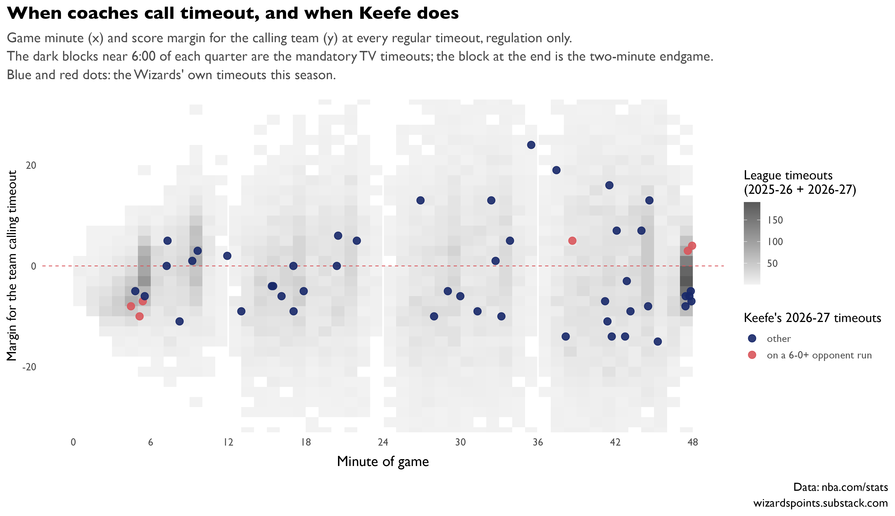

Across every timeout last season, the dark blocks are the mandatory TV timeouts around the 6:00 mark of each quarter and the two-minute endgame. Below that, the band under the zero line in the second half is the league's "stop the run while trailing" reflex: 18% of all timeouts come on the heels of a 6-0 or worse run.

### Do they stop the run?

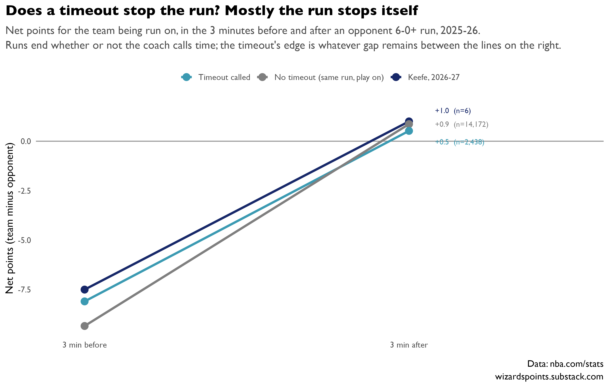

Teams on the wrong end of a 6-0+ run net **+0.5 points over the next three minutes if the coach calls timeout, and +0.9 if he doesn't** (14,000 runs with no timeout, 2,400 with). The run ends either way; it ends because runs are mostly noise. The timeout's measurable contribution to stopping it is zero or slightly negative — not because timeouts hurt, but because the coach who calls one is the coach whose team was being run on *harder*.

### What they run afterward

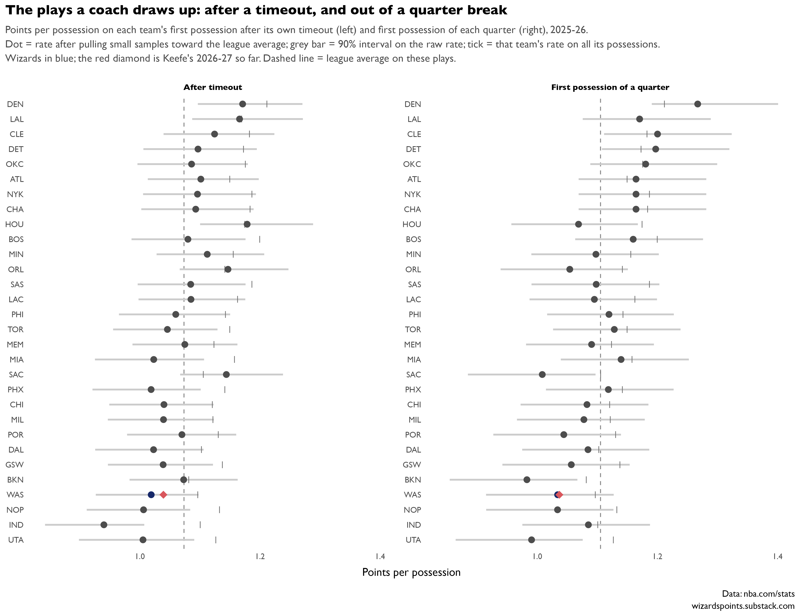

The one offensive possession a coach gets to draw up on a whiteboard is the one after his own timeout; the other is the first possession of a quarter. League-wide last season those scored **1.07 and 1.10 points per possession, against 1.15 on all possessions**. Set plays against a set defense, with no transition, score less than normal offense everywhere. The best after-timeout teams in the league are roughly at their normal rate; nobody is above it by more than noise.

The Wizards under Keefe: 0.95, 1.01 and (so far) 1.08 points per after-timeout possession across his three seasons, each about 0.08 below the team's own overall rate. This year's 1.08 raw (1.04 after shrinking the 52-possession sample toward the league) is 6th in the NBA; the first-possession-of-the-quarter play is 1.11, 11th. Small samples, but the whiteboard is not the problem.

### Keefe's own timeouts

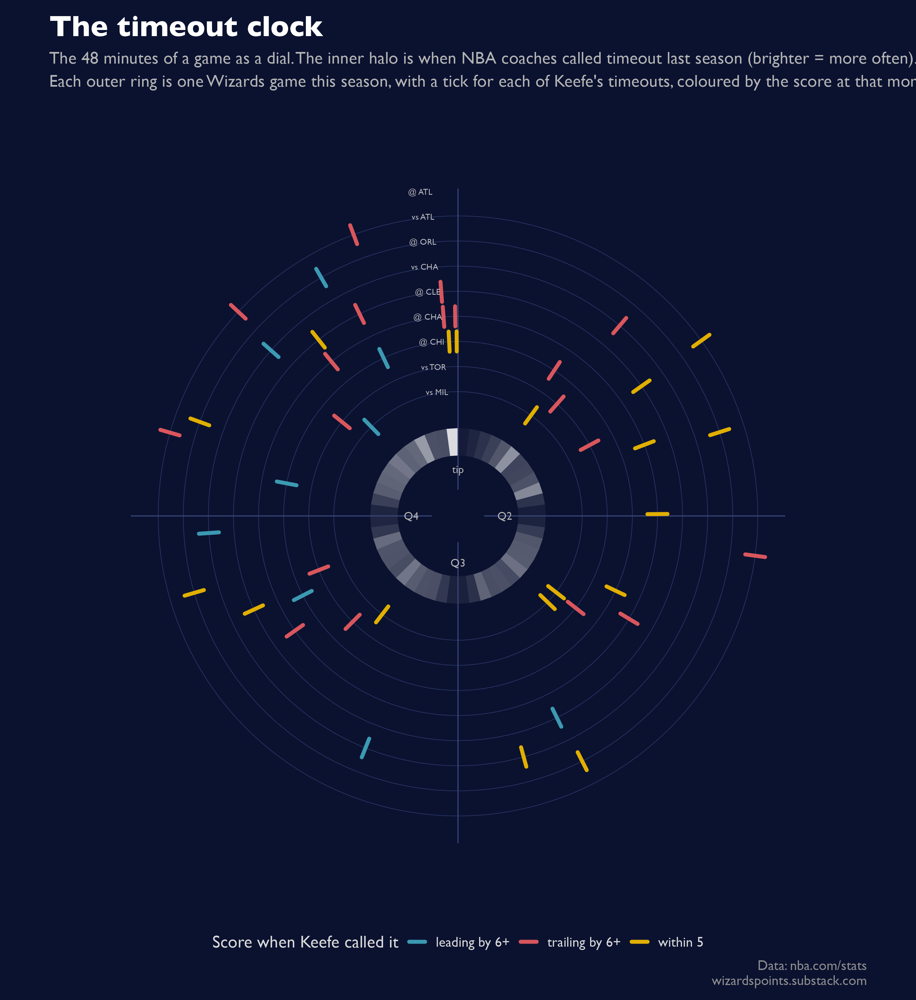

Last season Keefe was the league's most eager run-stopper: 5.9 timeouts a game (2nd-most), **25% of them on a 6-0+ run (1st of 30) and 79% while trailing (1st)**. This season, same number of timeouts (5.9) but only **11% on a run (28th)** and 58% while trailing. Either a 4-5 team is trailing less than a 17-65 one, or he has stopped trying to call runs dead — the data above says the second is the right instinct. He enters the final two minutes of close games with two timeouts in hand, league-typical.

### Challenges

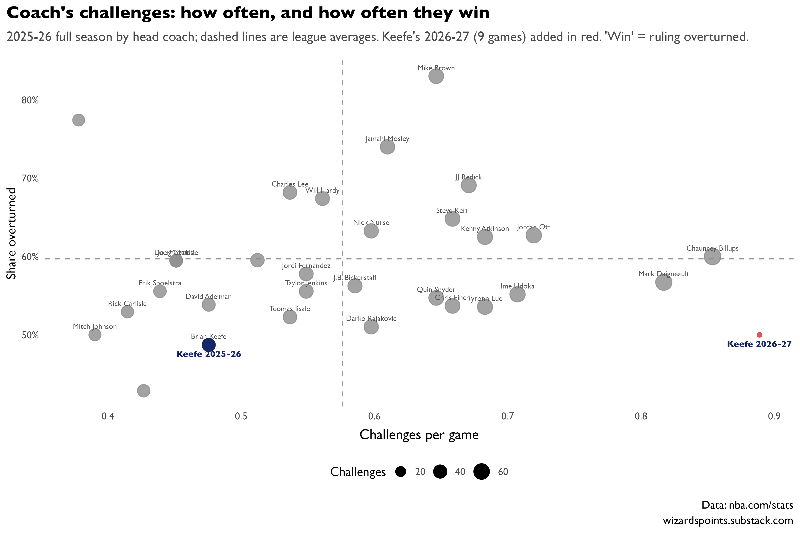

Last season coaches challenged about 0.6 calls a game and won 60% of them. Keefe challenged 0.48 a game (26th) and won **49% (28th)** — among the least frequent and least successful challengers in the league, after a 61% season the year before. This season he has challenged 0.9 a game (up sharply) and won 4 of 8. The challenge is the one decision here that is close to a pure skill test — reading the play, reading the referee, knowing the replay rules — and it is the one where his record is worst.

## 5. Keefe, nine games in

Putting it together, as a coaching scorecard rather than a win-loss one:

| Decision area | What the league data says a coach controls | Keefe, 2026-27 | Verdict |
|---|---|---|---|
| Tempo and ball movement | Strongly his | 19th pace, 28th passing — a deliberate slow-down | Style, not quality; no evidence it costs points |
| Late-clock stagnation | His | 15th, up from 25th–27th | The one offensive dial trending the wrong way |
| Shot selection | His | Rim-first (9th), few threes (29th), mid-range (5th) | Defensible for this roster; the missing threes are the cost |
| Shot making | Not his | League-average | — |
| Defensive scheme (fouling, contests, glass) | Partly his | 1st fewest fouls, 3rd contests, 4th-worst glass | Worst-3 defense for three years → 17th; the dials finally match the result |
| Rotation | His | 21st concentration, 11-deep, 4 starting fives | Still searching, not reactive |
| Timeouts | His | Stopped chasing runs (1st → 28th) | Correct — runs stop themselves |
| After-timeout plays | His | 6th in the league | Fine |
| Challenges | His | 49% last year (28th), 50% now | Worst mark on the card |

The honest summary: the things Keefe is measurably responsible for are mostly in reasonable shape, one of them (challenges) is bad, and one (late-clock stagnation in a slow system) is worth checking again at game 20. The things people will grade him on — the record and the ratings — are the things the league's own history says a coach moves least. If the Wizards are 30-52, it will mostly not be his doing. If they are 42-40, same.

## Appendix: time and lineups, as pictures

Two more views of the same data, built for looking at rather than reading.

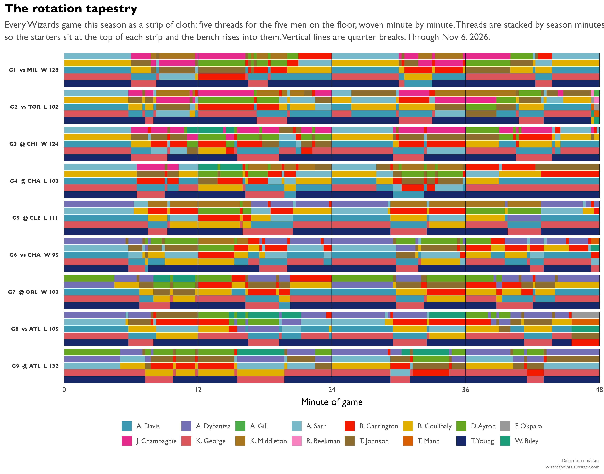

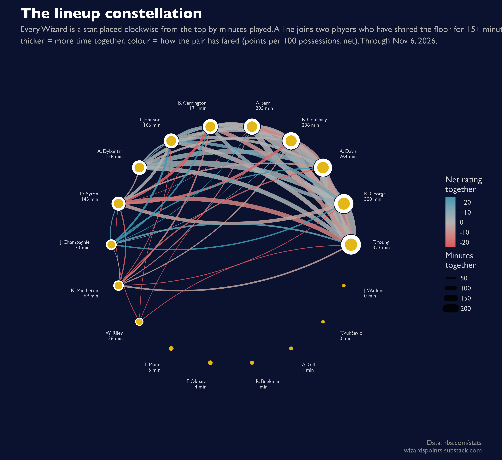

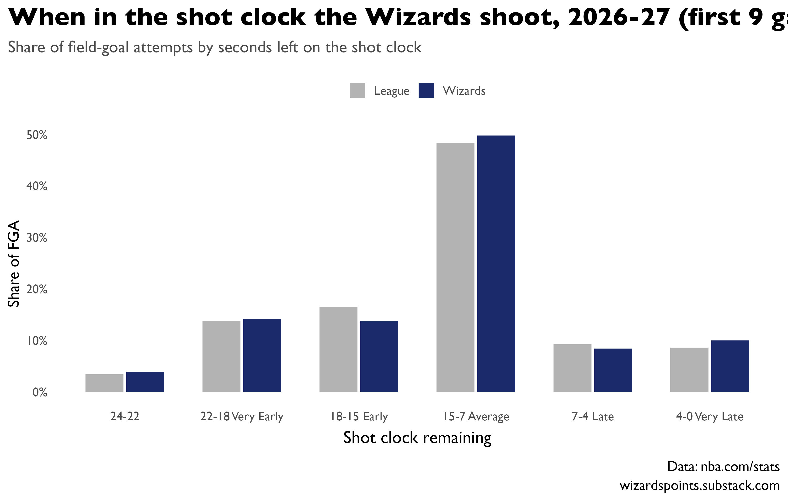

::: {.callout-tip collapse="true"}
## Caveats worth stating in the post
- "Coach of record" is the name nba.com attaches to a season, so mid-season firings (including Keefe's own 2023-24 takeover) are credited to the finishing coach; 12 of 420 team-seasons have no name and are dropped from the change analysis.
- Tracking "time of possession" changed definition when the league switched tracking providers in 2025-26; the 2024-25 figure is not comparable, so pace is used for history.
- Coach's challenges are attributed to the team penalised on the call under review (or the challenge-timeout row when one exists); 910 of 1,121 replay rows could be attributed.
- After-timeout possessions are scored from play-by-play with a simple possession walker (made shot incl. and-one, turnover, or opponent defensive rebound ends it); a handful of score-correction rows produce impossible values and are dropped.
- Nine games. Every Wizards number in this post has an interval wider than the difference it describes.
:::
